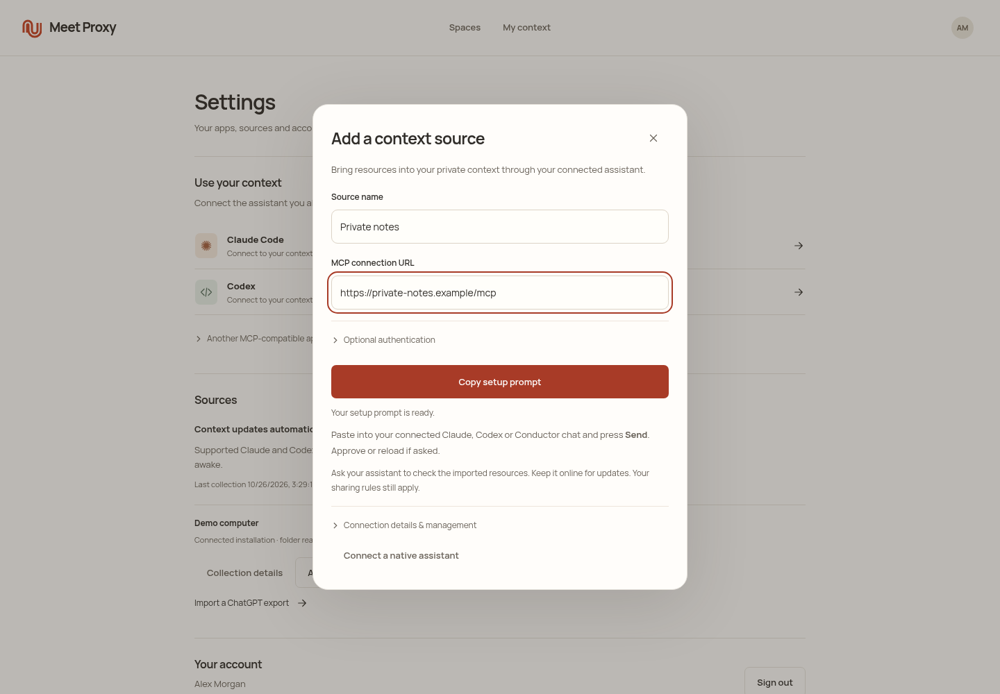
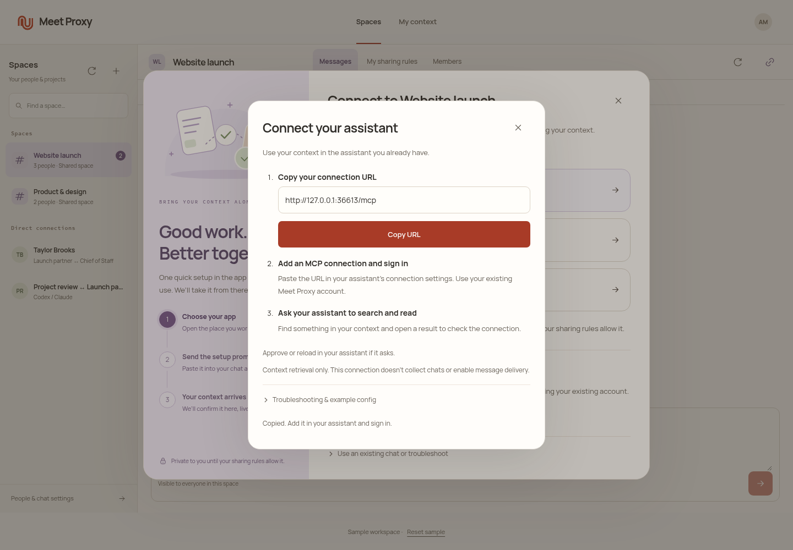
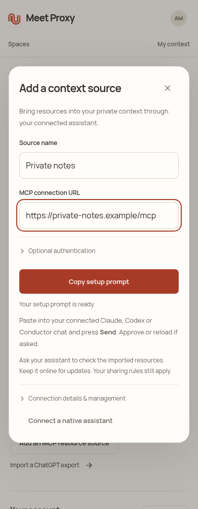
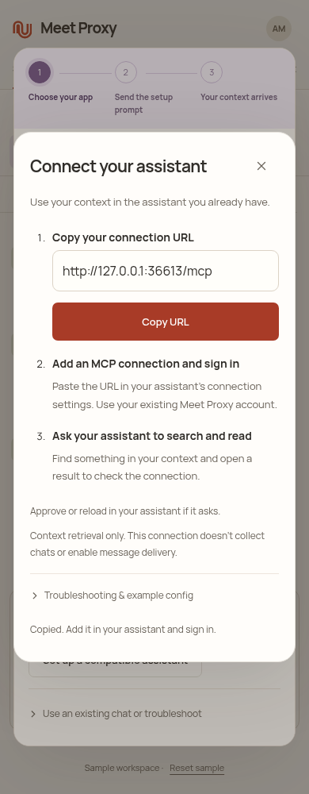

# Context completion — 26 October 2026

**The completion features are live.** Version 0.4.23 was published, installed
and deployed as `20261026-context-completion`. The subsequent
[0.4.24 P0 update](P0-NATIVE-READINESS.md) is published, installed and deployed as
`20261026-native-p0-final`; the Mac companion is running runtime57.
The earlier Mac binding block was resolved. Current receipts and remaining
real-host gates are in [the P0 verification record](../implementation/p0-native-readiness-verification.json).
The [Draft v3 recheck](SPEC-RECHECK.md) remains the historical requirement map.

## Implemented completion features

| Gap | Implemented behavior | Evidence and limits |
| --- | --- | --- |
| Large-account reads during archive rebuilding | Read the selected canonical document in a read-only worker transaction, then recheck revision and expiry before releasing text. Search and local mirrors still use the indexed snapshot. | A local 33.5-million-character, 4,200-section fixture returned reads during rebuilding in 270–331 ms; full build 1,003 ms. This does not establish production latency. Owner scope, citations, source exclusion, expiry and read transaction tests pass. |
| Long documents and more approved results | Exact Unicode-safe chunks with private context overlap; indexed relevant windows beyond 64k; six approved excerpts per page with a requester-bound opaque cursor. | Signed native/remote pagination, Unicode, stale nonce, rule/member/source revision and source-expiry tests pass. Budget: 32 chunks, 32 sources, four search pages, 128k read characters and 20 seconds for the complete gather/classify gate. Unsafe boundaries and ambiguous incomplete context withhold. This is bounded retrieval, not exhaustive access to every source. |
| Upstream MCP resources | Explicitly selected native source → official MCP resources/list/read → signed canonical capture → private archive → cited retrieval. | Real loopback HTTP and signed relay tests cover capture, exclusion/restore, disappearance/reappearance, unchanged-content receipts, restart and lost acknowledgments. Public HTTPS and numeric loopback HTTP supported. No arbitrary tools, stdio launch, OAuth to upstream sources, binary imports, template expansion or legacy SSE-only endpoints. No real external provider has been connected. |
| Source setup | Full-width name/URL fields, optional authentication collapsed, prominent Copy setup prompt and explicit paste/Send instruction. | Browser never submits the endpoint or bearer environment-variable name to the account service. Native tools own configuration and receipts. `sync_mcp_resource_source` returns promptly while capture runs; `list_mcp_resource_sources` distinguishes running from completed. The native runtime must remain online. |
| P1 compatible personal assistants | Three-step remote MCP/OAuth connection: copy URL, add connection/sign in, search and read. | Real DCR/PKCE, read-only tool filtering and cited retrieval in isolated account tests. This supports compatible MCP assistants; it does not certify every app, native wake, message delivery or chat-history collection. |
| P1 Contacts/email/iMessage invitation delivery | Owner-requested exact recipient/channel/text; ambiguous Contacts matches require selection; Mail compose/submit and Messages submit; durable nonce prevents duplicate or uncertain retries. | Packaged adapter tests pass. All three static AppleScripts compiled successfully on the Mac. TCC approval, Mail/Messages execution and delivery remain unverified and deferred as P1. No real contact messages were sent. Link fallback remains available; submitted never means received. |
| Shutdown reliability | Shared context work is tracked before its first asynchronous step; relay shutdown waits for handlers and archive work before closing SQLite. | Deterministic held-warmup/restart regressions and exact extracted package reruns pass. The previous failure was a real temporary-directory teardown race, followed by skipped cleanup hooks that leaked a listener. Logs retain the failure. |

The product stays **Spaces / My context**, with **Messages / My sharing rules /
Members** inside each space. Joining does not enable personal-library sharing.
Each new request requires every active contributor rule to pass; rejected text,
source metadata and classifier checks stay private. Uploaded shared files remain
explicit full-file contributions outside this gate. Legacy pair threads and
private mandates retain their existing scopes.

## Verification

| Check | Result |
| --- | --- |
| Final core/backend suite, including shutdown fix | 489/489 passed, no skips/failures |
| UI suite | 129/129 passed, no skips/failures |
| Original product lifecycle | 15/15 passed, no skips/failures |
| Exact extracted native ingestion + contacts + launchers | 32/32 passed; normal process exit |
| Both ZIP aliases, overlay/executable/asset integrity | Passed |
| Packaged zero-account → native collection → knowledge → sharing journey | Passed |
| Actual packaged stdio and signed relay | Passed |
| Six-profile packaged mailbox/onboarding/reconnect smoke | Passed |
| Portable implementation | All 23 patches reproduce 174 source files; candidate changes 50 files |

These checks overlap. They use isolated fixture identities and host transports
where indicated, and do not prove fresh Google consent, Mac app launch, Codex
Desktop setup or a production deployment. Source logs and original captures are
under `.context/remaining-gaps/`; their hashes are retained in the verification
record. The native ZIPs did not change for the server shutdown fix. The account
runtime bundle was rebuilt after it.

The real Perplexity `pplx-decider-v1.2` benchmark used 32 synthetic cases and
prompt version 3. At the unchanged **0.995** threshold it produced **25 correct,
zero false allows and seven false withholds**, with no provider errors; provider
p50 was 133 ms and p95 228 ms. This small sample is not a privacy guarantee or a
reason to lower the threshold. No private account source text was used.

## Historical candidate activation sequence

Publication, backup, installation and deployment are now complete. Follow the
[P0 record](P0-NATIVE-READINESS.md) for current real-host acceptance; the sequence
below describes the original candidate plan.

1. Restore this chat's authorized Mac binding by sending a message from Conductor
   on that Mac. Compile the static AppleScripts without executing or sending them.
2. Verify the reviewed release's ZIP/runtime hashes, current production baseline
   `20261026-revision-fence`, existing account/installation identity and disk space.
   Keep the existing accounts, scopes, bindings, permissions and database intact.
3. Publish the tested 0.4.23 artifacts before changing marketplace/download pointers.
   Deploy the reviewed runtime bundle using `scripts/deploy-cloud-update.py` from
   the portable source tree, with the exact baseline, bundle checksum and a new
   release name. Take the helper's verified SQLite backup and rehearsal path.
   Existing migrations are unchanged; three private pagination tables are additive
   on first use. Preserve the old release for rollback; never roll back account data.
4. Verify both services, a fresh runtime heartbeat, compiled `/authorize`, OAuth
   discovery, authenticated MCP, desktop/phone loading and public asset hashes.
5. Update the existing native plugin through its supported manager. Retain its
   one enabled alias and account. Run the already-authorized Claude search/read
   test with only the two approved per-run tools. Verify an actual read receipt
   and final answer, not a search-only answer or a queued turn.
6. Record actual installed/deployed receipts here. Real Codex Desktop and an
   owner-selected external MCP provider remain distinct acceptance checks.

No hosted answering model is required. Source collection still depends on a
running supported native installation; periodic collection is not instantaneous
and does not automatically ingest arbitrary repositories or web-only chats.
Optional document-picker drafts do not create recipient source grants. P2 and
unconfirmed proposed spec details remain outside the release claim.

## Desktop and phone captures

These are screenshots of the implemented UI with isolated sample accounts.
They are review evidence, not screenshots of production.

| Add a private context source | Connect another compatible assistant |
| --- | --- |
|  |  |
|  |  |
