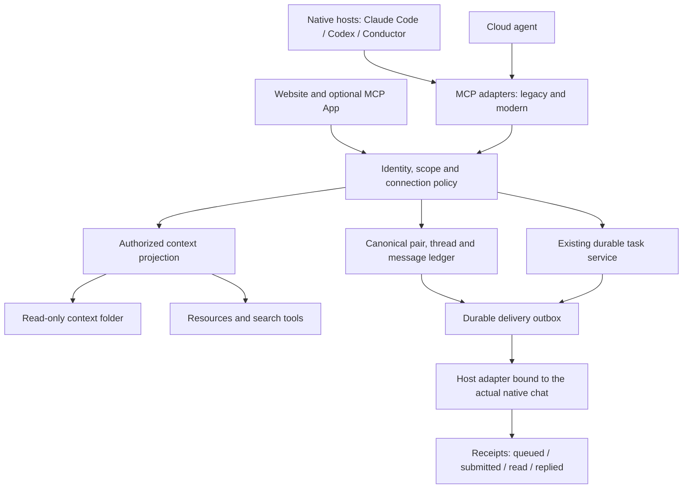

# Meet Proxy: MCP adoption and product completion plan

Research date: 24 October 2026. Status: proposed implementation plan; no runtime changes or deployment performed by this research.

Implementation follow-up: [0.4.19-rc.3 build report](MCP-BUILD-REPORT.md) and
[implemented contracts](MCP-CONTRACTS.md). The stages below remain the full roadmap;
the build report distinguishes completed source work from outstanding release gates.

## Recommendation

Use MCP as the common interface to Meet Proxy's context, actions, and durable work. Keep our existing context archive, local folder, search index, identity records, authorization rules, message ledger, and host receivers behind that interface. We can standardize much of how agents **access** the product; MCP does not supply the product's collection pipeline, relationship model, privacy policy, or ability to start a native chat turn.

The strongest immediate investments are:

1. Replace duplicated hand-written protocol handling with a tested adapter supporting both the installed 2025 clients and the **2026-07-28** protocol.
2. Expose the existing authorized context projection through **Resources**, retaining search/read tools and the local context folder for hosts that need them.
3. Add validated **structured tool results**, deterministic catalogs, bounded pagination, freshness metadata, and honest delivery states.
4. Complete the product spec's selected-agent connection flow using one pair/thread/policy service shared by the website and MCP tools.
5. Bridge existing cloud work to the official **Tasks extension**, after testing the actual client and SDK support. Add elicitation, Apps, and Skills progressively with working fallbacks.

Do not delay the product for filesystem writes, a new agent-orchestration standard, or universal host support. There is no defensible single percentage for “how much MCP replaces”: context access has substantial reusable protocol support; sync, permissions, relationships, inference, and native wake remain our responsibility.

The [research sources and coverage](MCP-RESEARCH-SOURCES.md) explain the status of each source. The local corpus contains all **357 unique official Markdown pages** indexed by MCP's `llms.txt`, also covering all 357 sitemap URLs, with hashes and retrieval timestamps. This is a bounded documentation snapshot, not every external discussion or third-party integration document.

## 1. Current implementation and concrete gaps

Code audited: `.context/commonplace-source` at `5479e52`; distribution workspace at `fce44da`. Paths in this section are relative to the source checkout. Local source is not evidence that a release is installed or deployed.

| Existing implementation | Consequence | Planned change |
| --- | --- | --- |
| `apps/commonplace/server/mcp.mjs:155` handles `initialize`, advertising up to 2025-06-18; `account-inbox.mjs:235` fixes 2025-03-26. | Cannot honestly claim modern protocol compatibility. | Shared adapter, explicit supported versions, conformance fixtures for each advertised version. |
| `apps/commonplace-account/server/archive-tools.mjs:115` and `cloud-network-tools.mjs:39` echo the requested version while serving legacy behavior. | Can report support for an unsupported revision. | Stop echoing arbitrary versions; negotiate only implemented behavior. Cover all four entry points. |
| `plugin.mjs` adds tool-list change support; tools are the main exposed primitive. | Large catalogs/instructions, limited portable context navigation. | Stable catalogs, output schemas, Resources, and optional workflow prompts. |
| `context-mirror.mjs` publishes immutable generations, digests, an atomic `current` link, and an index; `context-search.mjs` searches locally. | Much of the desired context-folder architecture already exists. | Reuse its authorized manifest/projection; add resource reads and parity tests, rather than a second archive. |
| `shared-context.mjs`, `cloud-archive.mjs`, `archive-tools.mjs`, and `unified-context.mjs` provide collection/search/read paths. | Multiple access surfaces can disagree on freshness or access. | One projection contract used by tools, Resources, folder generation, and cloud retrieval. Confirm actual module boundaries before extraction. |
| `mailboxes.mjs`, `delegations.mjs`, `shared-chats.mjs`, `people-invitations.mjs`, `social-agents.mjs` implement overlapping messaging/access models. | Monothread, browser acceptance, bilateral severing, and audit behavior differ by entry point. | Canonical selected-agent pair/thread service with separate connection policies and compatibility mappings. |
| Native receiver modules target specific hosts and actual chat identities. | Queued or submitted messages do not establish that a model ran. | Preserve host bindings; instrument delivery separately and verify exact-chat wake on each supported host. |

The previous [product-spec comparison](../.context/product-spec-gap-20261024.md) found substantial backend infrastructure but incomplete agent-first onboarding/home/inbox behavior. Its passing backend tests and earlier cloud Q&A result are historical evidence, not current end-to-end approval.

## 2. MCP capability decisions

“Adopt” means build and verify the adapter; it does not claim the feature already works in Meet Proxy or every host.

| Feature | Observed status | Meet Proxy use / decision |
| --- | --- | --- |
| JSON-RPC, capability/version handling, `server/discover` | Released core, 2026-07-28 | Adopt modern framing alongside supported legacy clients. |
| stdio | Released transport | Retain for native plugins and task-local tools. Keep stdout protocol-only. |
| Streamable HTTP | Released transport | Use for authorized remote MCP access; enforce headers, origin checks, auth and limits. |
| Tools, input schemas, output schemas, `structuredContent` | Released core | Adopt for search, connection actions, send/reply, status and task operations. |
| Resources, templates, resource links, text/binary content | Released core | Adopt for the context catalog, bounded document pages, shared threads and permitted code snapshots. |
| Prompts | Released core, user-selected | Add a small set for finding context, inviting a person, and starting scoped work where hosts expose prompts. No hidden automatic mandate changes. |
| Completion | Released core | Optional safe suggestions for prompt arguments/resource templates. It is not text search or model completion. Filter suggestions by authorization too. |
| Cursor pagination | Released core | Use opaque, bounded, snapshot-aware application cursors. MCP alone does not guarantee a consistent multi-page snapshot. |
| `ttlMs`, `cacheScope` | Released core | Add required modern cache hints; private projections use private authorization-isolated caches. TTL is not access permission or a background polling schedule. |
| Subscriptions and change notifications | Released core | Notify connected clients of changed resource/catalog state; repair missed events from durable application revisions. |
| Progress, cancellation | Released core | Use for synchronous requests. Keep durable task cancellation and native side-effect reconciliation separate. |
| Elicitation / multi round-trip requests (MRTR) | Released core; host capability required | Optional nonsecret agent/scope choices and external-workflow browser interactions. Keep browser/text fallbacks. |
| Tasks, `io.modelcontextprotocol/tasks` | Official extension, independently evolving | Bridge existing durable work after client/SDK tests. Do not build another queue or infer native wake from task notifications. |
| Apps, `io.modelcontextprotocol/ui` | Official extension; host-dependent | Optional in-chat agent chooser/invite/connection controls using the same backend as the website. |
| Skills, `io.modelcontextprotocol/skills` | Official extension, SEP-2640 Final; uneven implementation support | Later: distribute versioned workflow instructions and supporting resources. Keep packaged skills as fallback. |
| OAuth authorization, resource/issuer validation, CIMD | Released auth specification | Apply to remote MCP endpoints. Preserve existing Google identities and explicit account links. |
| OAuth Client Credentials / Enterprise-Managed Authorization | Official optional extensions | Defer until a machine/enterprise customer requires them; preserve task scope if introduced. |
| Server Cards / AI Catalog | SEP-2127 Final and merged; referenced implementation still labeled experimental | Optional endpoint discovery after schema/release reconciliation. Public server metadata only, never a directory of private people/chats. |
| MCP Registry / package metadata | Distribution infrastructure | Useful for discoverable verified releases. Does not attach native agents or accept human invitations. |
| Icons, annotations, titles | Released metadata | Improve UI/discovery, but treat them as hints, never permission or information-flow controls. |
| Trace context and stderr/OpenTelemetry | Documented conventions | Correlate RPC → application task → delivery receipt; exclude message/source content and credentials from telemetry. |
| Roots, Sampling, Logging | Deprecated in 2026-07-28 | Preserve only needed compatibility. Do not build new file access, model invocation, or wake functionality on them. |
| HTTP+SSE, Dynamic Client Registration | Deprecated; legacy compatibility remains | Retain only where installed clients require it; prefer Streamable HTTP and CIMD. |
| Filesystem create/update/delete/stat and binary streaming proposals | Not a released filesystem-write standard | Monitor; use standard read Resources now and ordinary authorized application tools for any later document editing. |
| Triggers/webhooks, Agents extension, progressive discovery, interceptors, HTTP-over-stdio | Work in progress/proposals | Keep adapters extensible; none is a production dependency for this plan. |

### The protocol upgrade is architectural

The [2026 changelog](https://modelcontextprotocol.io/specification/2026-07-28/changelog) changes behavior, not just a version constant:

- No modern `initialize`/`notifications/initialized` handshake or protocol-level `Mcp-Session-Id`. Requests carry protocol version and client capabilities in `_meta`; `server/discover` advertises the server.
- Results carry `resultType`; core supports `complete` and `input_required`, with `task` introduced by the Tasks extension. Legacy clients need their own encoding path.
- List results cannot depend on previous calls or connection state. Authorization-based filtering remains allowed. Opening a thread cannot secretly replace the tool catalog.
- Modern subscriptions use `subscriptions/listen`, including acknowledgment and subscription correlation; legacy resource subscription/HTTP GET behavior needs a separate compatibility path.
- Modern HTTP requests require version/method/name headers as applicable and validation against the body. Error codes and resource-not-found handling changed.
- SSE event-ID replay was removed. A retry has a **new JSON-RPC request ID** but the **same application nonce** for the same intended effect. Do not replay an uncertain native send automatically.
- `server/discover` and complete results of resource/list operations require `ttlMs` and `cacheScope`. MRTR continuation results must not be cached.

The official TypeScript repository contains a dual-era example. npm metadata retrieved during this research lists `@modelcontextprotocol/server` and `/client` **2.4.0**, the older monolithic `/sdk` **1.32.2**, and `/ext-tasks` **0.2.2**. Pin and verify published packages during implementation; a repository's root development version is not its published package version. SDK adoption is not a reason to rewrite our JavaScript service or introduce Rust.

The SDK's stdio auto-probe can spawn a short-lived sibling process. Our plugin must not register a second receiver, change a binding, open sign-in, or mutate setup merely because discovery ran. Keep discovery side-effect free, make receiver ownership explicit, and test this before enabling automatic probing.

## 3. Target architecture

Use one implementation of each policy regardless of which UI or protocol invokes it. Separate these identities explicitly:

1. Verified person/account.
2. Attached native agent and its host-verified chat binding/generation.
3. Selected agent pair, canonical conversation and connection authorization.
4. OAuth client, access token audience and granted scopes.
5. Task/execution/delivery attempt.

`clientInfo`, display names, arbitrary tool arguments, a persistent process and a Server Card are not proof of native chat identity. Handles identify application records; they do not authorize access. Validate the principal and current mandate on every operation and before releasing a result. A remote task may consult only the context and tools permitted by its original request.

Enforce a unique canonical thread for the sorted agent pair, while keeping directional mandates and their revisions separate. Each request records which owner's approved mandate governs the answer. Terminating the pair stops new work in both directions. Preserve original audiences when indexing old audit segments; consolidating identifiers must not re-share previously restricted material. Same-account agent access and cross-person delegation remain distinct policy cases.

## 4. Context folder, resources and code access

### One corpus, multiple access paths

Keep the collection pipeline and versioned context folder. The cloud runner and local agents should see authorized projections of the same canonical document identities, provenance and revisions. MCP Resources are another access path, not a new ingestion or AI-merging service.

Suggested logical resource URIs, subject to an implementation ADR:

| URI shape | Contents | Permitted audience |
| --- | --- | --- |
| `meetproxy://context/index` | Available documents, kinds, projects, capture times, exclusions/coverage status | Owner or explicitly scoped owner task |
| `meetproxy://context/documents/{id}/revisions/{revision}/pages/{page}` | Bounded text plus stable revision identity | Same authorization as source projection |
| `meetproxy://threads/{threadId}/pages/{page}` | Shared messages, participant display data and agreed boundaries | Authorized participants / retained audit readers where supported |
| `meetproxy://code/{snapshotId}/{path}` | Selected repository content pinned to commit/digest | Owner-authorized task; peer gets no raw code unless separately shared |

These are proposed application URIs, not MCP-defined methods. `resources/read` reads the URI; tools return resource links and typed search hits. A custom scheme avoids implying that a cloud URI is a path on the host. `file://` is also allowed for virtual filesystem-like resources, but never implies a mount, shell access, or unrestricted filesystem authority.

Projection rules:

- Search first, read bounded excerpts/pages, expand only relevant material. Do not push every transcript into each model prompt.
- Preserve exact text and source attribution internally. Indexing/deduplication should not overwrite contradictory statements with an AI-generated “truth.” AI synthesizes an answer when asked.
- Return capture time, archive revision, source availability, and gaps; distinguish current capture from cached/offline content. “All context” means supported, authorized, actually captured sources, not every host's hidden history or live code.
- Use one authorization/filtering function for list, search, read, resource templates/completion, mirror manifest and notifications. Count/title/URI leaks count as leaks.
- Store exclusions/tombstones in the canonical projection. Invalidate indexes and managed mirrors on exclusion or account change. Never silently merge different Google accounts.
- Bind opaque cursors to principal/scope, query and snapshot revision; invalid/expired cursor errors instruct a restart. Resource pages use pinned revisions. Verify access again even for a historical revision.
- Preserve the existing atomic generation publication and digests. Test interruptions, failed downloads, source changes during paging and old-generation cleanup. A read-only mode bit prevents accidental edits; it is not an adversarial sandbox or access-control boundary.
- Owner-only citations may resolve to private source URIs. Peer-facing answers expose only approved synthesis/shared references: no private citation IDs, paths, titles, hidden metadata, tool traces, or briefing text.

### Filesystem WG: what we can actually use

The [Filesystems charter](https://modelcontextprotocol.io/community/working-groups/filesystems) is aligned with our eventual needs: Resources create/update/delete/stat, optimistic concurrency, create-if-absent and cache invalidation. Its deliverable is still **Ideating**. Host materialization and write authorization are explicitly out of scope.

Status checked against GitHub, not just the charter:

- SEP-2571 (resource submission): **closed, not merged**, September 22; a WG-led successor is needed.
- SEP-2532 (binary resource streaming): **open, not merged**.
- SEP-1708 (client-brokered `files/*`): **closed**; “completed” on an issue does not establish a shipped standard.
- SEP-2356 (file inputs): **closed, not merged**, in favor of SEP-2631; SEP-2631 is also **closed, not merged** as inspected. Neither is a current portable upload contract.
- Skills' optional `resources/directory/read` belongs to that extension; it is not a universal writable filesystem API.

The reference filesystem server already offers tools such as read/write/edit/list/search/stat, but it needs explicit directory authorization. Its write implementation documents that overwrite is not crash-atomic. Do not point it at the full `.commonplace` profile directory, which contains more than context, or use it as the archive replication engine.

If writable shared documents become necessary before the extension settles, add narrowly scoped application tools backed by the existing document revision system: `expectedRevision`, conflict response, create-if-absent, size limits, audit trail and atomic persistence. Separate authored documents from imported transcripts; do not allow editing the imported archive or mirror in place. Later map the same service to a final filesystem extension. Do not invent `resources/update` or `files/*` methods and advertise them as standard today.

### When a question needs the codebase

A transcript archive is not a source checkout. Keep the two supported paths explicit:

1. Ask an authorized native agent to inspect a selected checkout, using its real host tools and permissions. Report the commit, dirty state, examined files and actual test commands/results in the owner's answer.
2. With owner authorization, publish a bounded repository snapshot to the owner projection, with commit/content digests and exclusions. A snapshot enables reading; execution needs an independently authorized runtime.

Never infer current code from an old chat snippet. If the machine is asleep and no adequate snapshot exists, report the gap or keep work durably waiting. MCP Resources and Tasks make these states portable; they do not provide credentials, execution access, or a wake guarantee.

## 5. Tools, durable work and change delivery

### Tool surface

Keep existing tool names during migration. Define a small preferred catalog organized around context discovery/search/read, agent discovery, connection invite/accept/sever, message send/read/reply, and task run/status/cancel. Retire redundant names only after usage and host migration evidence. Avoid a generic “execute any method” escape hatch that defeats schemas or host per-tool rules.

For each tool define input bounds, output schema, authorization, side effects, idempotency and error behavior. Use object-shaped structured results across both eras for compatibility, with serialized text fallback where appropriate. Distinguish malformed protocol calls from ordinary execution failures (`isError: true`). Delivery results must carry the actual state and waiting reason rather than “sent successfully” for merely queued work.

Schema validation must not automatically fetch network `$ref` targets. Bound schema depth, composition and validation cost; reject unresolved external references rather than accepting unchecked inputs. An SDK supplies framing/validation infrastructure, while our service supplies authorization and business invariants.

Use deterministic catalog ordering. Descriptions should explain purpose, disclosure boundary and meaningful recovery, with long workflows moved to user-selected prompts/skills where supported. Do not implement “open context X, then expose a different tool list” under modern MCP's stateless list rules.

### Tasks bridge

Use the existing task database and worker/outbox lifecycle as the source of truth. The modern extension introduces `tasks/get`, `tasks/update`, `tasks/cancel`, and `resultType: "task"`. It has **no modern `tasks/list` or blocking `tasks/result`**. Keep product task browsing as our own tool/resource if needed.

| Internal condition | Modern Tasks representation |
| --- | --- |
| Queued, executing, awaiting an offline device | `working`, with an accurate `statusMessage`; device offline is not automatically a question for the human |
| A real supported client input/consent choice is needed | `input_required`, with input request keys; reply through `tasks/update` |
| Answer returned | `completed`, with the tool result |
| Application/tool failure | `completed` with `result.isError: true`, per extension semantics |
| JSON-RPC execution fault | `failed`, with the protocol error |
| Cancellation actually reached terminal state | `cancelled`; cancellation acknowledgment alone does not establish this |

Expose task handles only when the current request advertises the extension. Unsupported clients retain our immediate ordinary result containing a durable application task ID and existing status tool. Task TTL is retention, separate from access expiry. Recheck authorization for get/update/cancel/notifications and final disclosure.

`tasks/update` acknowledges eventually consistent input handling. Deduplicate input keys and bind them to the original operation. Task cancellation is cooperative in MCP; preserve stronger application cancellation/disclosure fencing where possible, and accurately record side effects that had already happened. Modern task HTTP operations set `Mcp-Name` to `taskId`.

SDK caveat: the inspected Tasks package provides a generation-neutral requester, but its receiver helper explicitly targets **2025-11-25 sampling/elicitation**. Modern requester support requires `rawDispatch`/`v2RequestFraming`. Validate server-side 2026 support before selecting helpers; do not mistake that receiver for a ready-made modern task server.

### Notifications and native wake

Subscribe to resource/catalog changes and optionally full task state through `notifications/tasks`. Send only what the authenticated subscription may see, terminate or narrow subscriptions on revocation, and coalesce high-volume context updates. Synchronous progress/log notifications do not belong on a task subscription.

Keep a durable application cursor/revision and outbox. On reconnect, re-read state and catch up; MCP's notification stream is not a reliable message queue and does not provide exactly-once effects. A new RPC retry ID must not create a second application message/task.

For native delivery, retain the real host adapter and receipt distinctions. “Workspace resumed,” “message submitted,” “chat read,” and “reply received” are different observations. An uncertain host send waits for supported reconciliation; retries must not invent a replacement chat or silently move a receiver.

Claude Code's documented **Channels** can inject `notifications/claude/channel` into a running existing session. This is a host-specific research preview with authentication, organization and approved-plugin restrictions; the session must remain open. Custom channels are not currently on the documented approved allowlist. Evaluate an approved integration when available, without changing host permissions or using a development bypass as a production solution. This does not fix Conductor/Codex wake or a sleeping Mac.

## 6. Authorization, elicitation, UI and skills

### Remote authorization

For an exposed Streamable HTTP endpoint, implement OAuth 2.1 requirements, RFC 9728 protected-resource metadata and authorization-server discovery, PKCE S256, correct `resource` audience, issuer-bound stored credentials, and validation of issuer/audience/expiry/scopes. Prefer CIMD where supported; maintain bounded legacy compatibility. Prevent token passthrough, confused-deputy flows, metadata SSRF and redirect confusion. Do not put secrets or personal identifiers in optional routing headers or traces.

Keep application login, MCP authorization and external integrations distinct. Google sign-in identifies our account; it is not automatically an MCP resource-server token or native chat attestation. A capability declaration describes what a client can process; it is not owner consent. A peer message never increases authority.

### Elicitation

Use form mode for nonsecret agent selection or missing scope/duration. Use URL mode only for appropriate external workflows and verify completion through server state. Do not collect passwords/tokens in forms, and do not use URL elicitation as a replacement for authorization to the MCP server itself.

Modern MRTR retries carry `inputResponses` and `requestState`. Protect continuation integrity, bind it to principal, operation digest and expiry, and enforce single-use semantics where needed. Treat returned state as attacker-controlled input. Reuse existing approval/account state; do not make one-click acceptance ask the same question twice.

### Website and optional Apps

Build the website journey first, using the product spec: Google → attach agent if needed → Agents home → invite/accept → canonical thread. Existing signed-in users with attached agents choose an authorized agent and accept without another native setup handoff. New native attachments may still require real host approval/reload.

Optional Apps can render a chooser, invitation summary, boundaries, thread and sever action through a sandboxed `ui://` resource linked by `_meta.ui.resourceUri`. Use the same backend policy, CSRF/origin protections as applicable, bounded host-mediated tool calls, and restrictive CSP. Every action still validates authority server-side. App metadata, hidden fields and audience annotations are not safe places for private source data.

Provide useful text/browser fallback. Record actual host version and capability evidence; a blank client-matrix cell is not proof of either support or lack of support. Do not make P0 depend on an Apps-capable Codex or Conductor build.

### Skills and distribution

After core flows work, expose safe, versioned invite/context/delegation workflows via `skills/list`, `skills/get` and associated Resources. Verify manifests/digests and resolve identity by server plus URI. Reading a skill is not activation, source authorization or approval to execute its commands. Keep existing packaged skills for hosts without the extension.

The implementation matrix reports partial/planned host support and SDK work in progress; ChatGPT plugin import can be a static submission snapshot. Validate deployed behavior, not the presence of a specification. Registry metadata and optional Server Cards can simplify discovery later; retain verified release checksums and supported native installation paths.

## 7. Product requirements MCP does not finish

| Product requirement | Required application work | MCP contribution |
| --- | --- | --- |
| Agents home with active connections | Agent-row UI, connection counts distinct from online presence | Discovery/read tools or optional App |
| Invite → accept → connected | Attach invitation to selected existing agents; authenticated idempotent acceptance | Action tools, optional elicitation/UI |
| Exactly one thread per agent pair | Canonical pair uniqueness across mailboxes, delegations and links; migration mapping | Explicit thread handles only |
| Both owners read both sides | Complete shared audit projection with consistent participant metadata | Authorized thread Resources/read tools |
| Either side severs | Pair-level end-connection action, stop future sends/results on both sides | Authorized action tool |
| Time/topic boundaries | Visible default policy, service expiry/revocation and model disclosure discipline | Carry scope handles; auth does not interpret topic policy |
| Private sources stay private | Owner-only retrieval, sanitized peer synthesis, adversarial model evaluations | Resource isolation helps; metadata cannot enforce disclosure |
| Agent cannot exceed owner permissions | Host enforcement plus request-scoped execution and server checks | Capabilities/auth are inputs, not a universal permission delegation system |
| Direct email/iMessage invitation | Owner-authorized channel integration and recipient resolution | Potential separate connector; not a core MCP capability |
| Continuous supported-context collection | Host collectors, sync cursors, reconciliation, exclusions and monitoring | Resources expose collected data; subscriptions signal changes |
| Answering while unavailable | Durable work, supported running receiver/cloud execution, honest unavailable state | Tasks model lifecycle; no universal wake |

Use the spec's two-week/topic defaults as the proposed launch policy, visibly shown and enforced. Preserve existing stronger/narrower mandates in migration. Retained history after sever/expiry and editable boundaries are explicitly proposed in the spec: design audit-read permission separately from send permission, and decide the retention behavior before changing existing tests. Previously delivered content cannot be recalled from another party's copies.

## 8. Ordered implementation backlog

The stages below are scoped deliverables, not claims that this research completed them. P0 product work can proceed alongside protocol adaptation; optional extensions must not block it.

### M0 — Baseline and contracts

- Record source/deployed/plugin versions separately. Inventory every MCP entry point, installed host version and available capability.
- Add an ADR for identity, scopes, canonical pair/thread, projection metadata, nonce rules, and modern/legacy error mapping.
- Capture sanitized legacy fixtures; add a local client harness that can pin either era and either transport. Keep tests local by default using existing `dev:local` fixtures.
- Verify a pinned SDK build against our bundled Node/runtime/package workflow; assess startup, artifact size and probe side effects.

**Exit:** a reproducible host/version matrix and failing contract tests for observed gaps. No account reconnection or database rewrite is needed for this stage.

### M1 — Shared MCP adapter and structured tools

- Add a shared adapter module/package in the source checkout; adapt `mcp.mjs`, `account-inbox.mjs`, `archive-tools.mjs`, `cloud-network-tools.mjs`, and `plugin.mjs` to shared handlers.
- Preserve CLI entrypoints and old names; use per-era wire codecs and honest version support. New remote endpoints share business handlers rather than reimplementing policy.
- Add output schemas, bounded validation, deterministic lists, cache hints and request correlation. Correct unsupported-version and malformed-header behavior.

**Exit:** conformance and existing plugin/package tests pass for each advertised version; legacy setup/message flows still work; a discovery probe cannot mutate setup or acquire receiver ownership.

### M2 — Context projection and Resources

- Extract/adapt the existing archive projection contract; implement resources/list/templates/read and optional authorized change notifications.
- Map search hits to bounded revision-pinned resources; keep archive tools and local folder access.
- Add explicit coverage/freshness/exclusion reporting and optional owner-authorized code-snapshot descriptors.

**Exit:** tools, resource pages and folder text/digests agree on the same snapshot; account/scope/exclusion isolation holds across metadata, search, cache and notification paths; interrupted sync preserves a valid published generation.

### M3 — Spec-compliant connection and UI flow

- Unify pair lookup/creation, invite acceptance, connection policies, bilateral severing and audit projection across the messaging modules.
- Migrate with a mapping from legacy IDs to canonical thread IDs; keep original timestamps/provenance and old identifiers resolvable. Never merge unrelated agent pairs or widen existing grants.
- Build Agents home, existing-agent acceptance, thread views, active-connection state and sever controls in `context-assets` and shared backend routes.
- Make proposed audit-retention and boundary-editing choices explicit. Do not silently discard messages or supersede stronger scopes.

**Exit:** two authenticated users with existing agents accept in one browser action, reuse exactly one pair thread across both invite directions and repeated requests, see both sides, and can each sever. Agent presence and permission state are visibly different.

### M4 — Tasks and delivery recovery

- Bridge existing work in `cloud-work.mjs`, `cloud-worker.mjs`, `cloud-network.mjs` and `cloud-http.mjs` to the modern Tasks contract, retaining ordinary status-tool fallback and application browsing.
- Wire durable outbox/cursor catch-up, input deduplication, expiry/revocation checks and cancellation fencing.
- Add host-specific delivery diagnostics and repeated exact-chat wake tests; evaluate approved Channels support independently.

**Exit:** restart/reconnect/cancellation/retry tests pass; no duplicate message effect; native tests prove receipt and response in the selected chat. Unsupported hosts truthfully report waiting/blocked/uncertain instead of “connected and working.”

### M5 — Remote auth and optional UX

- Complete remote MCP OAuth discovery/token validation and negative-security tests before public remote exposure. If remote access ships earlier, pull this dependency forward.
- Add form/URL elicitation only for tested capabilities; add optional Apps after website parity; add prompts/Skills when supported by target hosts.
- Consider Registry/Server Card publication only after verified endpoint/schema/distribution readiness.

**Exit:** supported hosts use enhancements; unsupported hosts finish the same permitted workflow through existing tools/browser. No new sign-in loop, permission bypass or private-source disclosure.

### M6 — Rollout and launch evidence

- Stage independently controlled flags for modern protocol, resource exposure, task extension and UI enhancements. These are feature flags, not switches to weaken policy.
- Use additive data migrations and a reversible routing map. Back up before migration; shadow only read paths. Never dual-send to compare old/new delivery.
- Canary the same owner/local fixture first, then a consented two-account flow, then selected hosts. Preserve legacy IDs and queues during rollback.
- Roll back the adapter/extension independently if it fails; preserve committed messages/tasks and reconcile receipts. A cancellation or revoke must remain enforced after rollback.

**Exit:** publish a versioned evidence report with source/installed/deployed versions, passing cases, unsupported cases and known limits. Only then claim those specific host paths are production-ready.

## 9. Validation and benchmarks

Use the existing local lab, package smoke tests, browser tests and benchmarks. Add meaningful integration tests rather than tests that merely repeat schema constants. This research did not rerun product tests or perform a live messaging/deployment test.

| Suite | Required evidence |
| --- | --- |
| Protocol | Pinned conformance suite where supported; both eras/transports, discovery/fallback, invalid version/capability, headers, cache fields, pagination, bounded schemas, malformed JSON, process shutdown |
| Identity/auth | Cross-account resource/task/cursor/handle substitution rejected; spoofed clientInfo does not change native identity; invalid issuer/audience/redirect/PKCE rejected; existing account remains unchanged |
| Context/filesystem | Same snapshot across tools/resources/folder; traversal, symlink escape and races rejected; no credential directory exposure; crash during publish; digest mismatch; mid-pagination change; exclusion purged from managed projections |
| Retry/delivery | Disconnect before/after commit, process restart, duplicate nonce with identical vs altered payload, uncertain host acceptance, out-of-order receipts, no automatic acknowledgment loops |
| Tasks | Client capability absent/present; get/update/cancel authorization; duplicate input keys; expired retention; application failure vs JSON-RPC failure; cancellation racing result/send; fallback behavior |
| Product/browser | Both invite directions, existing/new user paths, chosen agent, one thread per pair, both owners read, both sides sever, visible expiry/defaults, keyboard/mobile behavior |
| Actual hosts | Exact version + transport + capability + approval state; Claude Code and Codex separately, Conductor separately; active/busy/idle/disconnected session; asleep device; reconnect and repeated delivery |
| Disclosure | Real model tests for raw-source requests, indirect source extraction, prompt injection, topic drift, recursive consultation, expired mandate and private metadata in UI/task/resource notifications |

Suggested benchmark dataset: **40 authored questions** with ground truth, replayed on a pinned archive/checkout and fixed model configuration. These counts and gates are proposed targets, not measurements:

- 10 direct context lookups, including rare literals and names.
- 10 multi-document questions with conflicting/stale sources and required attribution.
- 10 current-code questions: symbol location, execution path, bug diagnosis and running a specific test through an authorized receiver.
- 10 unavailable, excluded, unauthorized or out-of-scope requests that should report limits or refuse disclosure.

Compare the current tools-only path with Resources + search and, where supported, Tasks. Measure retrieval recall@5/@10, answer correctness, citation correctness, unsupported claims, freshness handling, tokens, time to first useful result, total latency and native delivery latency. Score owner answers and peer-safe answers separately; private citations are not a peer benchmark requirement.

Proposed acceptance gates: all deterministic isolation/idempotency cases pass; zero observed cross-account/private-source disclosures or invented code execution in the test set; at least 95% correct direct retrieval and 90% supported answers on the authored answerable set, with every missing-access case accurately labeled. A finite test set cannot prove “never leaks” or “answers everything.” Report failures and denominator rather than an overall marketing score.

For native wake, run at least 20 sequential ask/reply cycles per supported host pairing plus explicit restart/disconnect/busy cases. Count success only when the selected recipient actually replies on the correct thread. Report median/p95 latency and stalls; exclude no failures silently. A new prompt typed manually into the receiver does not prove automatic wake.

Existing useful source-checkout commands: `npm test`, `npm run test:package`, `npm run test:plugin`, `npm run test:ui`, `npm run test:local`, `npm run benchmark:agent`, and `npm run benchmark:worker-agent`. Scope execution to changed components first; add scripts for protocol conformance and the authored dataset as part of implementation. Browser/host prerequisites and real human approvals remain explicit.

## 10. Decision register and unresolved dependencies

| Decision / uncertainty | Resolution |
| --- | --- |
| Use MCP Resources for the whole folder? | Yes, as an authorized read projection alongside folder/tools; no forced whole-corpus prompt injection. |
| Need AI to combine the archive? | No prerequisite. Index exact attributed content; use AI to synthesize task-specific answers. |
| Adopt filesystem write proposals now? | No. Preserve CAS-ready service boundaries and watch WG progress. |
| Replace native receivers with MCP subscriptions? | No. Subscriptions notify connected clients; host controls model turns. |
| Rewrite in Rust? | No evidence-based need for this migration. Use the existing Node service and official SDK; profile before considering a separate collector/indexer implementation. |
| Latest spec equals installed host support? | No. Maintain the measured compatibility matrix and legacy fallback. |
| Server Cards readiness? | Final SEP conflicts with experimental implementation wording. Reconcile exact released schema/tooling before adoption; not on the critical path. |
| Subscription teardown wording? | Current cancellation and subscription pages differ in graceful-close wording. Resolve against pinned schema/SDK/conformance behavior and track upstream ambiguity; do not invent behavior. |
| Audit history after sever and editable boundaries? | Product-spec proposals. Make a concrete retention/migration decision before changing permission behavior; sending stops independently. |
| Is everything production-ready after this research? | No. This delivers the research and implementation plan. The staged code, migration, host and real-model evidence remain to be produced. |

The first implementation slice should be **M0/M1 plus the M2 projection contract**, while M3 remains the product-critical flow. Tasks and richer UI follow demonstrated interoperability; filesystem proposals and experimental agent orchestration stay off the launch dependency chain.
