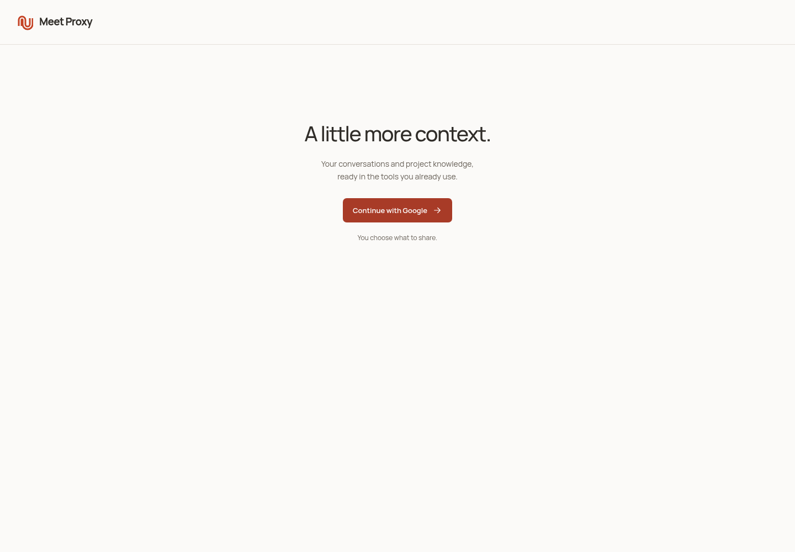
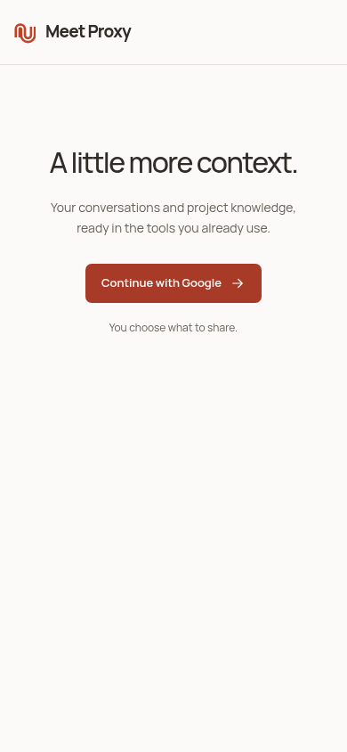

# P0 native and production readiness — 26 October 2026

**0.4.24 / runtime57 is published and installed. Production is
`20261026-native-p0-final` at https://34.27.253.220/.** The completion features
from 0.4.23 are live. This record supersedes the older candidate and blocked-Mac
statements; the original Draft v3 remains unchanged.

The rollout preserves **Spaces / My context**, with **Messages / My sharing
rules / Members** in each space. Shareable invitation links/codes are P0.
Direct Mail/iMessage sends are P1 and deferred. Existing owner retrieval needs
no hosted answering model; optional sharing rules use the configured classifier.

## What changed

Real Mac testing found that Codex delivers its actual native chat identity in
MCP request metadata, rather than the server environment. The adapter now accepts
matching host-supplied IDs on native stdio requests and binds the exact chat before
activation. It rejects provider conflicts, changing identities and missing
identity after binding. HTTP metadata and tool arguments cannot establish a
native identity; identity does not grant account consent or host permission.

The macOS background installation was also pinned to 0.4.18. It now follows the
loaded plugin version, preserving the installed marker on a failed host bootstrap.
Existing open chats may retain old plugin code until reloaded. The actual Mac
companion reached revision57 only after its own active-work guard accepted a
graceful update. No daemon locks, saved permissions or accounts were reset.

## Release and deployment evidence

- [Published 0.4.24](https://github.com/diask5/commonplace-plugin/releases/tag/meet-proxy-v0.4.24).
  Source is merged in PR19; installation pointers in PR20.
- The supported Claude manager updated the existing `meet-proxy@commonplace`
  alias. Account `diaskyle10@gmail.com`, server and chat bindings were preserved.
- The bundled Codex helper updated only the existing plugin executable paths;
  other TOML and permissions were unchanged. Codex Desktop is installed as
  `/Applications/ChatGPT.app`, bundle ID `com.openai.codex`.
- Production's exact156-file baseline and new156-file bundle were verified.
  Only the generated adapter and the legacy setup download reference changed.
  All three services are active and the runtime heartbeat is current.
- The database backup is
  `/var/lib/commonplace/rollouts/20261026-native-p0/before.sqlite`.
  A redundant full rehearsal was stopped while still isolated because of slow
  disk I/O. Activation used the helper's code-only mode, which requires the exact
  existing migration set and applied digests. No schema or data rollback occurred.

## Verification boundaries

| Check | Result |
| --- | --- |
| Full core/backend regression | 495/495 passed, zero skips |
| Focused native identity, adapter, host and background tests | 26/26 passed |
| Final extracted identity, ingestion and launcher tests | 20/20 passed |
| Both ZIP aliases and all overlay bytes/modes | Passed |
| Packaged stdio and signed service journey | Passed |
| Six-profile onboarding, mailbox and reconnect test | Passed; Google/host fixtures identified explicitly |
| Portable implementation | 24 patches reproduce178 source files exactly |
| Unchanged UI and original lifecycle | Previous129/129 and15/15 passed |
| Live public desktop1440 / phone390 | Google visible; no overflow or script errors |
| Real Codex native identity | Verified actual thread from host request metadata |
| Real Claude Code search → read | Passed; actual read returned the exact synthetic marker after two safe revision retries; saved permissions unchanged |
| Real Codex search → read | Passed; actual host identity, successful search and document read returned the same exact synthetic marker; config unchanged |

The real Google browser flow opened Spaces successfully using an existing Google
session. Its signed-in account differs from the Mac plugin account. No native
relink was attempted; the owner must select which account the final desktop
handoff should use. This is not a fresh-account/consent test.

The public browser checks do not certify Google consent. The native CLI tests do
not certify an app deep link, an already-open Desktop chat reload, or every fresh
user setup. Share invitations, exact-pair uniqueness, two-sided audit, revocation
and private-rule checks have signed integration/browser evidence; no new
cross-person production invitation was sent during this rollout.

Real upstream MCP provider setup is a separate extension check. Contact scripts
compiled on the Mac, but direct sends, delivery receipts and P1 personal-assistant
coverage are deliberately outside this P0 release claim.

Exact hashes, runtime receipts and remaining acceptance work are recorded in
[the verification JSON](../implementation/p0-native-readiness-verification.json).
Raw diagnostic and failure logs remain under `.context/p0-live/` and in the Mac's
private verification directory; source text, credentials and private prompts are
not included in this document.

## Live public screenshots

These show the deployed sign-in surface, not a simulated signed-in account.

