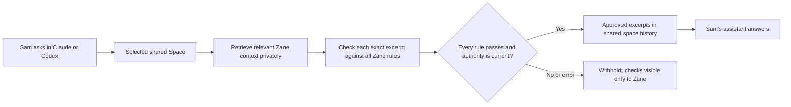

# Sharing between people: stress results, 29 October 2026

The context store and classifier are the shared interface. Claude and Codex are
clients of it. The stress run found working privacy boundaries, inconsistent
useful sharing, missed natural-language queries, and provider saturation. It also
found and fixed a consent-resurrection bug in source at the time of this run.
That fix is now live in [server 20261029-cross-host-sync](CROSS-HOST-CONTEXT-SYNC.md);
the original stress results below remain unchanged. This is not an
all-P0 or production-readiness pass.

## Where the classifier belongs

For the spec's Sam/Zane example, under the later Spaces amendment:



The requester never receives the private library before classification. The
current server does not generate an answer and then classify it: it classifies
verbatim candidate excerpts with private surrounding evidence. Sam's existing
assistant can answer from the admitted context. That last generation step was
not exercised by these server tests. Answer generation followed by a disclosure
check would be a separate architecture change needing its own verification.

Membership, contributor opt-in, policy revision, expiry and source revision are
checked independently of model scores and rechecked before disclosure. Each
candidate must pass every rule. Sources and peer text cannot amend those rules.
The saved policy's audience is all current and future members of the selected
space, because approved excerpts remain in its history. A rule allowing only one
named person does not authorize a wider audience. Use the intended space and
scope; membership alone does not enable library sharing. Explicit uploads remain
a separate, whole-file sharing action.

## Results

| Exercise | Observed result | Evidence boundary |
|---|---|---|
| Existing sharing suites | 72 tests passed | Before the new fix; deterministic/backend/MCP and invitation browser coverage |
| Added stress suite | 14 tests passed after the fix | Isolated SQLite, ten distinct synthetic owners, injected classifier responses |
| Ten-owner deterministic load | 30 requests, 160 approved excerpts, 640 checks; maximum 8 active checks per owner and 80 overall | Transport/authority enforcement, not model judgment |
| Single-owner contention | One request runs; 39 competing requests get 429; completed replay is idempotent | Includes cross-space contention and mismatched nonces |
| Real classifier corpus | 36 cases, 29 correct, 7 permitted items withheld, no forbidden item allowed, no provider error | 12 permitted and 24 forbidden cases; one attempt each |
| Real archive-to-space path | 8 scenarios / 10 candidate messages; 3 of 4 permitted messages shared; all 6 forbidden messages withheld | Actual archive search/read and provider, synthetic native records; no host model |
| Ordinary-question retrieval probe | 4 of 7 answerable phrasings found the source; absent quoted phrase stayed absent | Real archive with deterministic allow classifier to isolate retrieval |
| Real ten-owner burst | 40 calls; 30 HTTP 429; zero of 10 public answers shared; no private bytes or checks disclosed | One burst, synthetic candidate injection, real SpaceContext and provider |
| Full core suite after fix | 625 passed | Includes the 14 added stress tests; do not add them again |
| Browser suites after fix | 27 passed | Exchanges, context spaces and invitations; synthetic auth/classifier |
| Portable replay | All 50 patches reproduced 211 changed files exactly | Source-only reproducibility |

The real model was `pplx-decider-v1.2`, prompt version 3, cutoff **0.995**. The
main evaluation made 56 calls and the separate burst made 40, for 96 calls total.
No automatic retries, threshold adjustments, prompt/model changes or production
account writes occurred. Tests calling a real provider are explicit scripts and
are not added to the automatic test suite.

Across the first two real-provider exercises, **8 of 16 permitted candidates
were withheld** and **0 of 30 forbidden candidates were released**. These small,
hand-labelled samples do not establish a privacy guarantee. In the correction
scenario the current date and reason were shared; the old planned date was the
permitted item withheld. The named-recipient-only case named Sam, who was not
among that preview's members; it is not isolated proof of future-member handling.

The burst's failure has two observed contributors: nine public candidates had at
least one provider error, and the remaining public candidate's two scores were
below cutoff. Errors withheld content but do **not** count as successful semantic
privacy checks. The per-request eight-call bound is not a provider-wide limiter;
the ten-owner real burst reached 40 simultaneous calls. No load was sent to the
production Meet Proxy service.

## Consent bug and source fix

Before patch 50, the sharing opt-in was considered valid when the policy save
time was greater than or equal to the member's join time. A save, removal and
re-add within one millisecond could therefore make an old policy active again.
A backwards clock could do the same. The preserved reproducer failed with
`true !== false` on the expected disabled state.

`Groups.addMember` now explicitly disables a returning member's existing policy
and increments its revision within the existing transaction. Rule text is
preserved, stale saves fail, and a fresh owner opt-in is required. Initial joins
and legacy groups without a policy table remain supported. Regressions exercise
equal timestamps, a clock moving back 60 seconds, withheld requests, stale saves
and fresh opt-in. No classifier or audience rule was weakened.

**Release state:** patch 50 is source-only, not packaged, installed or deployed.
Published native 0.4.32/runtime65 and server `20261029-question-discovery` are
unchanged. The production server therefore still needs the consent fix released.

## Remaining blockers to dependable automatic answers

1. **Recall:** all-term keyword matching misses ordinary paraphrases even when
   the exact relevant source is present. The question-word fallback does not
   solve predicates such as “going live now,” “catch me up,” or “what changed.”
   No classifier is called on these misses; they are not withholding decisions.
2. **Admission usefulness:** the current model/prompt/cutoff still withholds
   explicitly permitted facts. Wording and complete context affect scores.
   Lowering a cutoff until these examples pass would not validate safety.
3. **Provider capacity:** concurrent owners multiply provider calls and hit 429.
   Admission control and capacity handling need a provider-wide design that
   preserves the deadline, all-rule checks and final authority/source fences.
4. **Release and acceptance:** release the consent fix through the checked
   deployment path, then repeat real-account acceptance. Native setup approval,
   clean onboarding and independent-human acceptance remain separate.

No existing host denial was retried, probed or bypassed. All test preview servers
and temporary databases were closed by their cleanup handlers. Existing production
sharing settings and historical benchmark/video evidence were left intact.

## Reproduction and retained evidence

[Verification manifest](../implementation/sharing-stress-verification.json) ·
[ordered source patch](../implementation/sharing-stress.patch) ·
[patch manifest](../implementation/sharing-stress-manifest.json) ·
[real classifier results](../implementation/sharing-stress/real-classifier.json) ·
[real burst results](../implementation/sharing-stress/real-load.json) ·
[question recall](../implementation/sharing-stress/question-discovery.json).

After applying the ordered patches in a source checkout:

```sh
node --test tests/space-context-stress.test.mjs
node scripts/probe-sharing-questions.mjs
```

The following explicitly call the configured hosted Perplexity provider with
synthetic data, using the existing secure environment-file configuration:

```sh
node scripts/stress-sharing.mjs
node scripts/stress-sharing-load.mjs
```

The first stress harness failed before exercising requests because its synthetic
contacts had not been connected. That setup error, its corrected run, the genuine
pre-fix regression and the final run are retained separately. No failing baseline
was relabelled as a pass.
